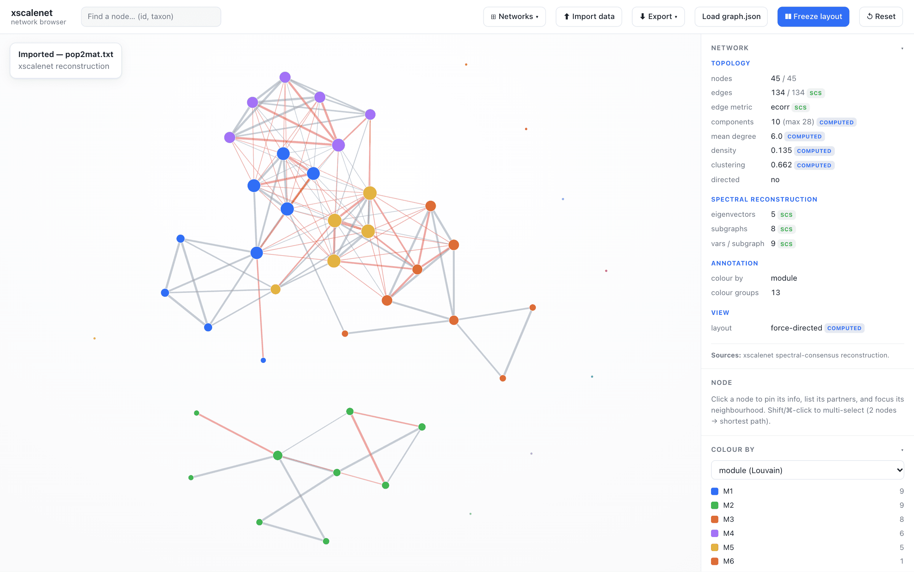
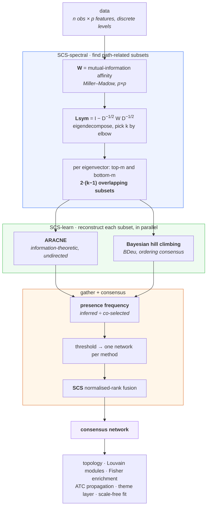
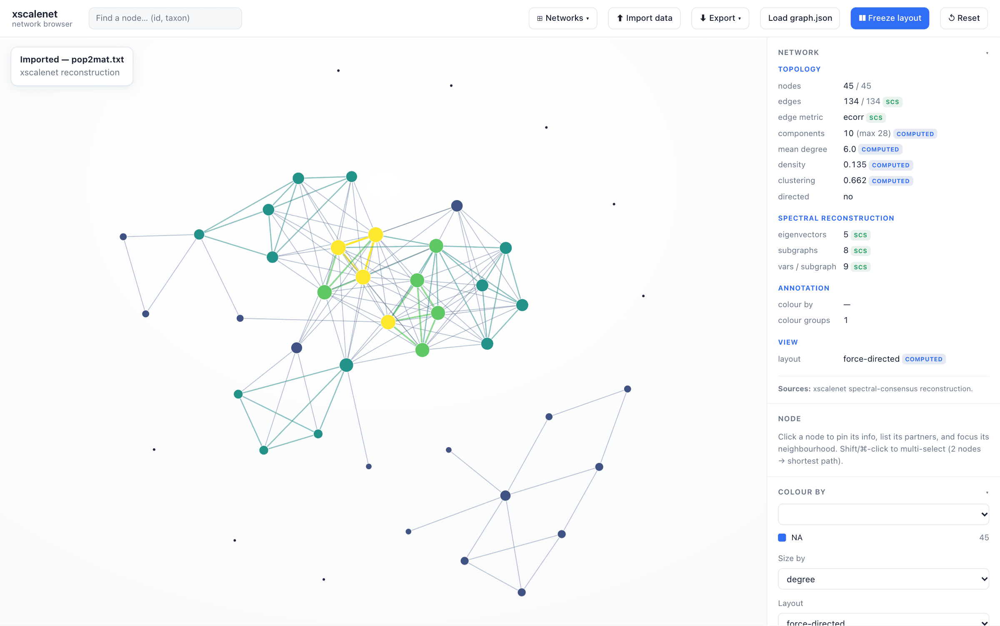
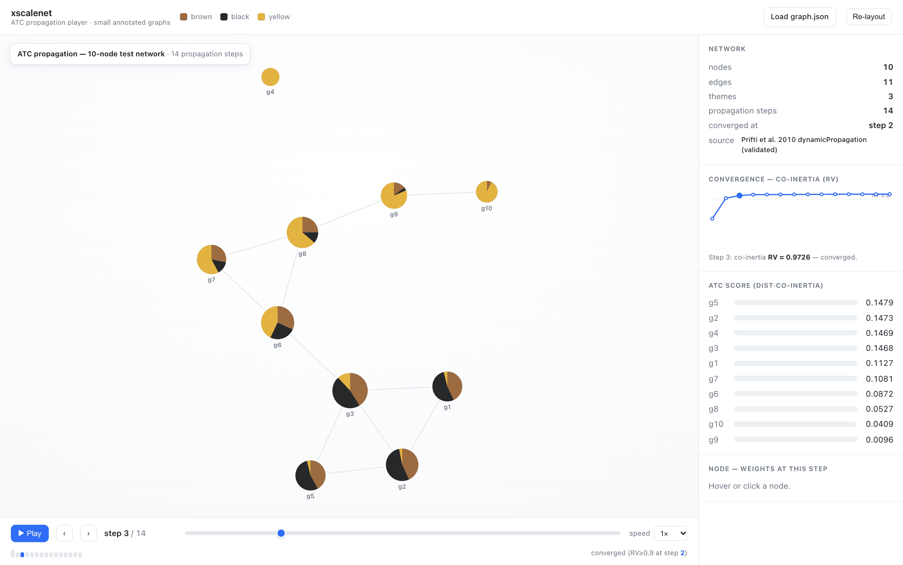

<div align="center">

# xscalenet

**Reconstruct networks from high-dimensional data — spectral subsets, consensus fusion, annotation propagation.**

A fast, dependency-light Rust implementation of the [ScaleNet](https://github.com/UMMISCO/scalenet)
spectral framework and its **Spectral Consensus Strategy**, with a browser for
exploring what comes out.

[](LICENSE)
[](Cargo.toml)
[](docs/r-mapping.md)
[](tests/order_invariance.rs)
[](docs/)

</div>



> Reconstructing a network over `p` variables breaks down as `p` grows — in the
> 2016 paper's microbiome case, Bayesian hill-climbing on ~2 000 variables did
> not converge in 48 hours. ScaleNet's answer is not a faster solver but a
> different problem: **don't learn one big network — learn many small,
> overlapping ones on spectrally chosen variable subsets, then aggregate.**

---

## Quick start

```sh
cargo build --release
cargo test  --release                       # 27 tests, ~1 s

# reconstruct: features in columns, observations in rows (plain or .gz)
./target/release/xscalenet tests/data/pop2mat.txt out --edges-only

# explore it in the browser
cargo build --release --features web --bin xscalenet-web
./target/release/xscalenet-web web          # → http://localhost:8788/network.html
```

The run narrates itself, and the narration *is* the algorithm:

```
# Loaded 45 variables x 25 observations
# Kept k=5 eigenvectors, 8 subgraphs, m=9 vars/subgraph
# WARNING: on 3 of the 4 eigenvectors the G+/G- cut falls inside a block of
#   numerically-tied components [...] Caused by duplicate or near-duplicate
#   variables; collapse them before reconstruction.
# Reconstructing with aracne...
# Reconstructing with bayes_hc...
# Consensus @ presFreq 0.3: 134 edges
# Consensus @ presFreq 0.8: 118 edges
```

That warning is real, and this fixture earns it: `pop2mat` has 19 duplicate
columns, which make the subset selection genuinely ill-posed. The run says so
instead of returning a number that looks reproducible and is not.

New here? Start with the **[hands-on training](docs/training/)** — two tracks,
one for analysts and one for contributors, with exercises that all run on the
bundled fixture.

## How it works



The subsetting is what makes it scale; the consensus is what makes it
trustworthy. Full derivation in **[docs/algorithm.md](docs/algorithm.md)**.

## What you get

| | |
|---|---|
|  | **See the subnetworks that made it.** Every node and edge tinted by how many of the `2·(k−1)` spectral subsets project onto it. The dense core where subsets overlap glows bright; the periphery fades. This is the SCS idea, made visible. |
|  | **Watch an annotation diffuse.** Annotation Transcriptional Centrality (Prifti et al. 2010) propagated as a dynamical system until the co-inertia of successive configurations converges. Each node is a pie of its theme mix; the curve tracks RV; the bars rank nodes by ATC. Validated against R to <1e-4. |

Also in the browser: edge filters that compose, a **scale-free** power-law fit
that recommends a `|ecorr|` threshold, Louvain modules with per-module Fisher
signatures, FunNet functional layers laid out by MDS, ego-network focus,
shortest paths, and ATC recomputed on the topology you actually finalised. The
whole analysis state lives in the URL, so a view is shareable and reproducible.
See **[web/README.md](web/README.md)**.

## Reproducibility

Three properties that reconstructions of this kind do not usually have, each
pinned by a test in [`tests/order_invariance.rs`](tests/order_invariance.rs):

| Change to the input | Effect on the network |
|---|---|
| Shuffle the columns | **none** — edge Jaccard 1.0000 |
| Rename the variables | **none** — edge Jaccard 1.0000 |
| Change `--seed` | small, honest Monte-Carlo variation (0.98–1.00) |

Measured on four genus presence/absence matrices, full pipeline, 10 permutations
and 10 renamings each. Before version 0.2 the first row was **0.23–0.39**:
`Lrw = I − D⁻¹W` is not symmetric, yet it was decomposed as if it were, from its
lower triangle — so permuting the columns changed *the matrix being decomposed*.
R ScaleNet has the same flaw, [fixed in parallel](https://github.com/UMMISCO/scalenet/pull/1);
both implementations now produce identical edge sets.

The second row needed more than a deterministic tie-break. Hill climbing keeps
the first best-scoring move it finds, so the visit order decides every tie —
and ordering by *name* is invariant to column order but not to renaming, while
ordering by *position* is the reverse. Names and positions are equally arbitrary
labels. The base order is therefore derived from **the variables' own data**,
which escapes both, and `--hc-orders` random orderings are fused on top so the
result does not rest on one arbitrary scan order either.

Two inputs stay **intrinsically** ambiguous and the run says so rather than
pretending otherwise: duplicate variables make eigenvalues degenerate, so no
unique eigenvector exists; and a subset cut falling inside a block of
numerically-tied components is arbitrary at the available precision. Collapse
duplicate variables to remove both.

`--legacy-lrw` reproduces the pre-0.2 behaviour exactly, so analyses published
before the fix can still be regenerated. Details in
**[CHANGELOG.md](CHANGELOG.md)**.

## Command line

```
xscalenet <input(.tsv|.gz)> <output_dir> [options]
```

Features in columns, observations in rows; plain or gzip, auto-detected.

<details>
<summary><b>All options</b></summary>

| Option | Default | Meaning |
|--------|---------|---------|
| `--methods` | `aracne,bayes_hc` | reconstruction methods to embed |
| `--var-perc` | `0.2` | fraction of variables per subgraph (`m`) |
| `--eigen-perc` | `auto` | fraction of eigenvectors (`auto` = elbow heuristic) |
| `--thresh` | `0.3,0.8` | presence-frequency thresholds |
| `--epsilon` | `0.001` | ARACNE DPI tolerance |
| `--restart` | `21`, or `0` under ordering consensus | hill-climbing random restarts |
| `--hc-orders` | `200` | random variable orderings fused per subgraph |
| `--hc-order-freq` | `0.0` | drop arcs seen in fewer than this fraction of orderings |
| `--seed` | `6196` | PRNG seed |
| `--discretize` | off | PAM-discretize numeric columns first |
| `--transpose` | off | input has features in rows |
| `--edges-only` | off | write only present edges (skip absent pairs) |
| `--max-clusters` | `5` | max PAM clusters per discretized column |
| `--maxp` | unlimited | max parents per node (hill-climbing) |
| `--max-iter` | `10000` | hill-climbing iteration cap |
| `--iss` | `1.0` | BDeu imaginary sample size |
| `--metrics` | off | per-node topological metrics on the consensus network |
| `--metrics-weighted` | off | use `\|ecorr\|` edge weights for metrics/ATC |
| `--atc <annot.tsv>` | — | propagate a node annotation (ATC centrality) |
| `--atc-col <name>` | col 2 | annotation column to propagate |
| `--theme-network` | off | build the multi-layer theme-proximity network |
| `--scale-free` | off | sweep `\|ecorr\|` thresholds, fit `P(k) ~ k^−γ`, recommend one |
| `--json` | off | also export `graph.json` |
| `--iterative-eigen` | off | Lanczos eigensolver (needs a fixed `--eigen-perc`) |
| `--legacy-lrw` | off | reproduce the pre-0.2 column-order-dependent pipeline |

</details>

Ordering consensus costs real time on the Bayesian method — about 9 s on a
135-variable matrix at the default. Lower `--hc-orders` knowingly on large
inputs, or use `--methods aracne`, which is exactly invariant at no cost.

### Outputs

Same layout as the R package:

```
out/globalGraph/globalNet_presFreq<t>/edgesList.<method>.txt
out/consensusGraph/globalNet_presFreq<t>/edgesList.txt
out/consensusGraph/globalNet_presFreq<t>/edgesList.consensus.rawAvg.txt
```

Edge-list columns: `x  y  epresenceScore  epresence  eorientScore  eorient  ecorr`.
Edge existence comes from mutual information (non-linear, unsigned); `ecorr` is
the signed Spearman, so it carries the *direction of co-variation*, not the
strength.

With `--metrics` / `--atc`, `nodeAnalysis.txt` adds degree, strength,
betweenness, closeness, clustering, Louvain `community`, the modular-centrality
pair, and `atc`/`atc_last`; `enrichment.txt` and `themeNetwork.txt` follow from
an annotation. `--json` exports a self-contained `graph.json`.

```sh
xscalenet net.tsv out --discretize --metrics --atc taxonomy.tsv --atc-col genus
```

## Beyond the CLI

| | |
|---|---|
| **Library** | Two I/O-free entry points, `run` and `analyze`, returning typed structs — [docs/integration.md](docs/integration.md) |
| **Python** | `pip install maturin && maturin develop --release -m bindings/python/Cargo.toml` — [bindings/python](bindings/python/) |
| **Server** | `xscalenet-web` reconstructs an uploaded matrix locally and serves the browser |
| **In-browser** | `./scripts/build-wasm.sh` compiles the engine to wasm — reconstruction with no server at all |

Everything speaks `graph.json`, the interchange format specified in
[docs/suite.md](docs/suite.md), so any tool that emits it plugs into the whole
analysis and UI stack.

## Validated against R

The pipeline around reconstruction — MI, Laplacian, eigendecomposition, gather,
Spearman sign, consensus math — is numerically exact against the original R
package, and the regression suite pins it on the bundled `pop2mat` fixtures:

| Output | Result vs R fixture |
|---|---|
| ARACNE edge set @ 0.3 / 0.8 | **exact** — 205/205 and 168/168 |
| `epresenceScore`, `ecorr` | agree to ~13–15 significant digits |
| Eigenvector count / subgraph structure | exact (`k=13`, `m=9`, 24 subgraphs) |
| `bayes_hc` edge set | ~80 % overlap, **by design** |

Those fixtures were produced by R's own column-order-dependent spectral step, so
the regression tests run them through `--legacy-lrw`; the numbers above are the
legacy path's. Hand-rolled hill climbing diverges from `bnlearn` in restart RNG,
tie-breaking and search order, and Bayesian structure search is sensitive to all
three — the ~80 % is the expected consequence of an *algorithmically faithful*,
not bit-identical, port. ARACNE contributes no consensus disagreement.

ATC propagation is validated against `integranet::dynamicPropagation` to <1e-4,
the theme-proximity layer to <1e-5, and Fisher/Benjamini–Hochberg to <1e-6.

## Documentation

| | |
|---|---|
| [docs/training/](docs/training/) | **hands-on course** — two tracks, exercises, worked solutions |
| [docs/algorithm.md](docs/algorithm.md) | the method and its formulas, as implemented |
| [docs/architecture.md](docs/architecture.md) | module-by-module, data model, where parallelism lives |
| [docs/r-mapping.md](docs/r-mapping.md) | what maps to which R source, and what is out of scope |
| [docs/integration.md](docs/integration.md) | library API and `graph.json` |
| [docs/suite.md](docs/suite.md) | how the components fit together; the format spec |
| [docs/performance.md](docs/performance.md) | cost model, bottlenecks, optimisation history |
| [web/README.md](web/README.md) | the network browser and the propagation player |

## Scope

The **core `spectral` path** of the original package. Deliberately not ported:
the comparison-only subset strategies (`random`, `spectralKmeans`,
`spectralFuzzyCmeans{Order,Sample}`, `spectralBipartition`), the `3off2` method
already dropped upstream, non-`pamk` discretizers, and the diagnostic plots.

## Citation

> Affeldt S, Sokolovska N, Prifti E, Zucker J-D. *Spectral consensus strategy for
> accurate reconstruction of large biological networks.* BMC Bioinformatics 2016;
> 17(Suppl 16):493. [PMC5249011](https://pmc.ncbi.nlm.nih.gov/articles/PMC5249011/)

ATC and the two-layer model: Prifti et al., *Bioinformatics* 2010 and 2008.

## License

GPL-3.0-or-later. See [LICENSE](LICENSE).
